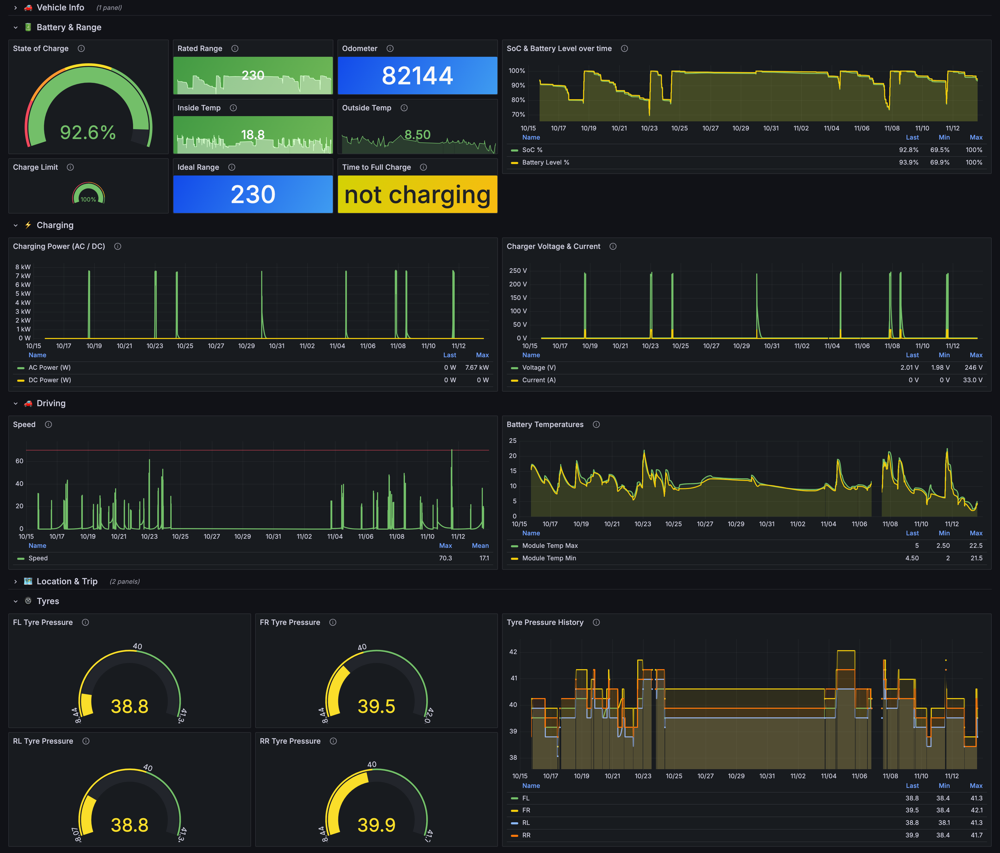
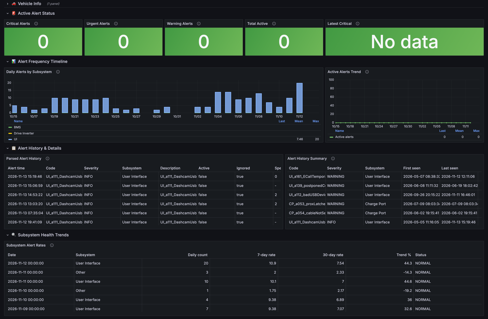
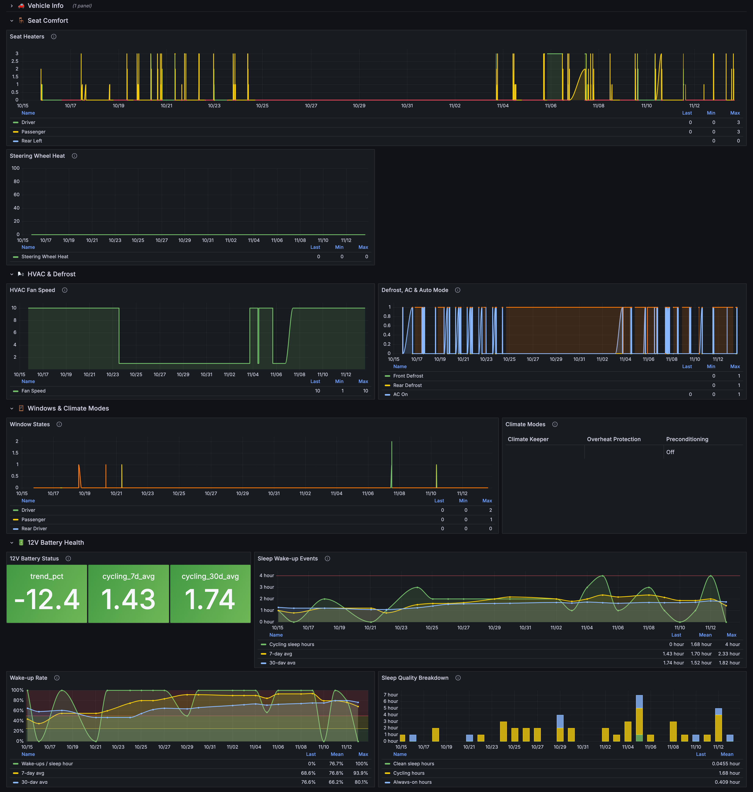
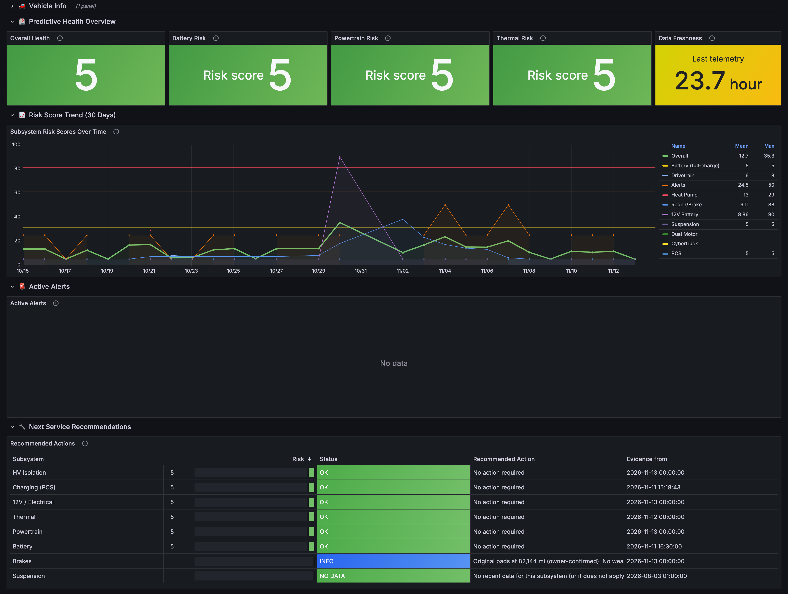
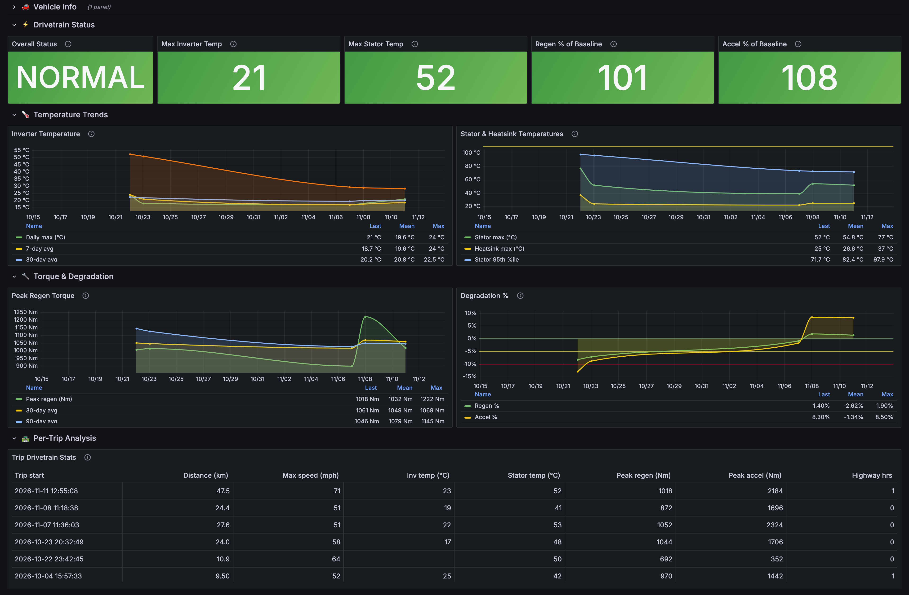
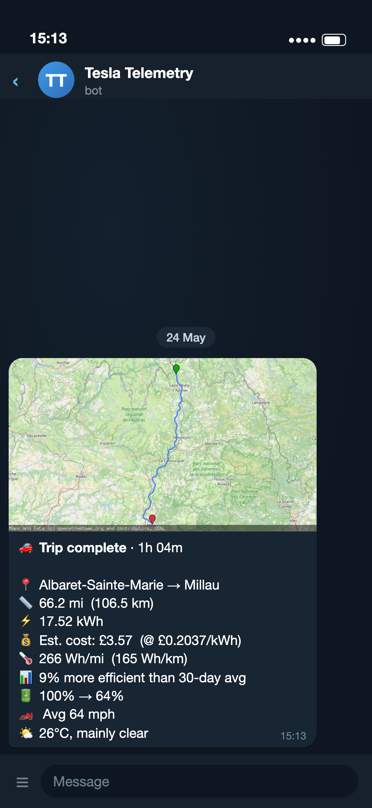

[](https://github.com/teslamotors/fleet-telemetry/actions/workflows/build.yml)
[](https://github.com/teslamotors/fleet-telemetry/tags)
[](https://hub.docker.com/r/tesla/fleet-telemetry/tags)

# Tesla Fleet Telemetry
---------------------------------

> **🚗 Fork Overview & Enhancements**
>
> This fork extends the official Tesla reference implementation into a **complete, production-ready observability stack**. It transforms the raw telemetry receiver into an end-to-end analytics platform with a TimescaleDB backend, predictive diagnostics across 11 vehicle subsystems, and 16 pre-built Grafana dashboards — served behind nginx mTLS.
>
> **Key Additions:**
> - **PostgreSQL / TimescaleDB Dispatcher:** A custom Go datastore module (`datastore/postgres/`) that writes incoming telemetry directly into TimescaleDB with continuous aggregates, compression, and 5-year retention.
> - **59 SQL Migrations** (`001`–`058`, two `005` files; applied in `deploy/sql/migrations.txt` order, not filename order): Schema, views, unit-conversion functions, GPS-based trip sessionisation, charge session detection, and full predictive diagnostics for battery, drivetrain, heat pump, suspension, brakes, PCS, dual motor, and Cybertruck subsystems (`deploy/sql/`).
> - **Predictive Health Engine:** Cross-subsystem risk scoring (`predictive_health_summary` view) that weights 11 subsystems into a single 0–100 risk score with recommended actions.
> - **16 Grafana Dashboards** (`00`–`15`): Pre-provisioned via Docker Compose with auto-discovery — see screenshots below.
> - **Experimental capacity-fade estimate (Packfade method):** per-drive apparent pack capacity (V×I energy ÷ share of SOC used) with a robust, temperature-adjusted trend and a bootstrap interval, computed daily by `tools/notify` and shown on the Battery Health dashboard. The method is adapted from [Packfade](https://github.com/pgodlews/packfade) (MIT licence) by the same author. See [Experimental: capacity fade](#experimental-capacity-fade-packfade-method).
> - **Experimental route-efficiency monitor:** routes the car drives often are found from the data and used as a repeatable test of energy per distance (temperature, trip duration and HVAC fan adjusted), so a lasting drift points at tyres, alignment, a dragging brake or load. Shown on the Regen & Brake dashboard. The repeated-route idea comes from [Packfade](https://github.com/pgodlews/packfade)'s approach (MIT licence), by the same author. See [Experimental: route efficiency](#experimental-route-efficiency).
> - **Telemetry Simulator:** Generates realistic 90-day synthetic history for dashboard development without a real vehicle (`tools/simulator/`).
> - **Extensive Deployment Runbook:** Covers Let's Encrypt + nginx mTLS, EC keypair generation, Tesla Developer API registration, virtual key pairing, and DNS automation (`deploy/README.md`).
>
> > ⚠️ **Experimental features:** The whole **Predictive Health Engine** — the diagnostic and scoring views from `deploy/sql/005`–`017`, as reworked by `025`–`041` — and the **Telemetry Simulator** (`tools/simulator/`) are early-stage beta features. Several inputs are proxies (the 12 V score is DC-DC activity, brake wear is a mileage model, PCS "failure" compares two different current signals). Diagnostic scores and wear estimates may be inaccurate — do not rely on them for safety or maintenance decisions without independent verification.
>
> ### Upstream vs This Fork
>
> | Layer | Upstream | This Fork |
> |-------|----------|-----------|
> | **Ingest** | Go mTLS WebSocket server | Same — no core protocol changes |
> | **Persistence** | Kafka, Kinesis, Pub/Sub, MQTT, ZMQ | **+ PostgreSQL / TimescaleDB** |
> | **Schema & Analytics** | None | **+ Hypertables, PostGIS, trip views, unit-conversion SQL functions** |
> | **Visualisation** | None | **+ 16 Grafana dashboards** (Overview, Predictive Health, Energy, Alerts, etc.) |
> | **Testing** | Basic integration tests | **+ Synthetic telemetry simulator** covering all 239 vehicle fields |
> | **Deployment** | Helm chart reference | **+ Docker Compose stack + full operator runbook** |
>
> ### Architecture
>
> ```text
>                                Production Server (Ubuntu + UFW)
>                               ┌─────────────────────────────────────────────────────┐
>                               │                                                     │
>                               │  Nginx (HTTPS / Let's Encrypt / EC Key Serving)     │
> Owner (Browser) ── HTTPS :443 ─┼─►                                                   │
>                               │   │                                                 │
>                               │   │       Docker Compose Stack                      │
>                               │   │     ┌─────────────────────────────────────────┐ │
>                               │   └────►│ Grafana (:3003)                         │ │
>                               │         │   ▲                                     │ │
>                               │         │   │ (SQL Views & Dashboards)            │ │
>                               │         │   ▼                                     │ │
>                               │         │ TimescaleDB (PostgreSQL + PostGIS)      │ │
>                               │         │   ▲                                     │ │
>                               │         │   │ (Raw Telemetry Insert)              │ │
>                               │         │   │                                     │ │
> Tesla Vehicle ──── mTLS :4443 ─┼────────►│ fleet-telemetry (Go)                    │ │
>                               │         └─────────────────────────────────────────┘ │
>                               │                                                     │
>                               └─────────────────────────────────────────────────────┘
> ```
>
> - **TimescaleDB** stores every telemetry field as a single hypertable with composite PK `(ts, vin, field)`. PostGIS handles GPS points. Compression is enabled (7-day chunks).
> - **PostgreSQL dispatcher** is a first-class `telemetry.Producer` (~550 LOC, with integration tests). It unmarshals protobuf records, handles numeric/string/geo types, and writes in batches.
> - **SQL analytics layer** lives in `deploy/sql/`:
>   - `001_schema.sql` — hypertable, indexes, PostGIS
>   - `002_views.sql` — trip detection via GPS time-gap sessionization, energy per trip (kWh, Wh/km), battery drain, speed stats; pivotable user-preference views for dynamic unit conversion
>   - `003_grafana_role.sql` — read-only DB user for Grafana
>   - `004_field_catalog.sql` — searchable field metadata
> - **Grafana dashboards** use query variables (VIN selector, time range) and call SQL helper functions (`to_dist`, `to_temp`) so the same dashboard works for metric or imperial vehicles.
> - **Simulator** (`tools/simulator/`) generates realistic driving/charging data directly into TimescaleDB, letting you develop and demo dashboards without owning a Tesla or exposing a public endpoint.
>
> ### Key Technical Decisions
>
> 1. **Single hypertable, EAV-style** — One `(ts, vin, field, num_value, str_value, geo_value)` table instead of dozens of typed tables. This matches the streaming protobuf schema and makes adding new vehicle fields zero-downtime.
> 2. **Trip detection in SQL** — Rather than maintaining stateful session logic in Go, trips are derived via a SQL window function that detects >5-minute GPS gaps. This makes the definition inspectable, versioned, and easy to tune.
> 3. **Unit conversion at query time** — The car reports its preferred units as telemetry fields. Grafana reads the latest preference per VIN and passes it into SQL functions. No hard-coded units in the dashboards.
> 4. **Two-domain architecture** — `tesla.example.com` serves the mTLS fleet endpoint; `ft.example.com` serves the static EC public key for Tesla partner registration. This isolates the public-key serving requirement from the telemetry port.
>
> ### Dashboards
>
> | | |
> |---|---|
> | **Overview** — SoC gauge, rated range, odometer, inside/outside temp, charging power history, UK map position, TPMS pressures | **Summary** — Hero stats (SoC, range, charge state, power, temp), TPMS, speed/power chart, firmware version, colour, wheel spec |
> |  |  |
> | **Energy** — AC/DC/regen/drive kWh totals, SoC history, charge-curve scatter (power vs SoC), lifetime energy (33 MWh), pack voltage/current | **Map & Trips** — GPS route on dark map, per-trip table (duration, distance, avg/max speed, SoC start/end, energy used) |
> |  |  |
> | **Powertrain** — Live motor torque/current, pack voltage, longitudinal/lateral G-force, inverter temps, brick voltage spread, isolation resistance | **Battery Health** — Capacity fade trend, degradation %, brick voltage delta, range-at-rest history, active alert list |
> |  |  |
> | **Alerts** — Critical/urgent/warning counts, frequency timeline by subsystem, full alert history with severity and timestamps, 30-day trend | **Climate & Comfort** — Seat/steering heater usage, HVAC fan, defrost/AC modes, window states, climate settings, 12V battery cycling |
> |  |  |
> | **Regen & Brake Health** — Overall NORMAL/WARNING status, brake pad record, regen % trend, peak regen torque curve, brake events per 100 mi | **Safety & Autopilot** — Cruise set vs actual speed, safety feature states (AEB, blind spot, FCW, lane assist), speed limit and emergency braking status |
> |  |  |
> | **Security & Access** — Sentry mode timeline, locked state history, Pin-to-Drive/valet/guest modes, door and window open events over time | **Predictive Health** — Subsystem risk scores over time, active alerts, next-service recommendations per subsystem (experimental) |
> |  |  |
> | **Drivetrain Health** — Overall status, inverter and stator temperature trends, peak regen torque, degradation %, per-trip drivetrain stats | _(+ Suspension & Alignment, Service Log)_ |
> |  | |
>

---

## Experimental: capacity fade (Packfade method)

> ⚠️ Experimental. Not part of the predictive health score.

The method is adapted from **[Packfade](https://github.com/pgodlews/packfade)** (MIT licence), an e-bike battery
degradation tool by the same author. Packfade infers fade from %SOC per km; the car reports pack voltage and current, so
each drive gives an apparent capacity directly: energy that left the pack (trapezoidal V×I integral, 90 s gap cap) ÷ share
of SOC used. Route, wind and load cancel.

- **Observations:** `packfade_segments` (migration `057`), one row per drive. Drives with charging inside, under 90 %
  power-sample coverage or under 5 % SOC used are rejected and the reason is recorded.
- **Fit:** Packfade's model — `ln C = b0 − bt·t + γ·temperature`, weighted least squares (delta-method SOC variance plus
  an environmental floor), Huber IRLS (k = 1.345, MAD scale), seeded date-clustered bootstrap for the 95 % interval.
  Implemented in Go in `tools/notify/packfade` (the fitting routine is a port of Packfade's browser engine; see the file header).
- **Running:** the notify daemon recomputes it once a day; `tesla-notify --packfade-once` recomputes on demand
  (`--dry-run` prints without storing). Results: `packfade_estimate`, `packfade_points`, `packfade_curve`.
- **Shown:** Battery Health dashboard (09), row "Experimental — Packfade method".
- **Limits:** it relies on the BMS SOC, and an LFP pack's SOC drifts between full charges; current and voltage are
  sampled every 30 s; with months of data the interval is wide, and the dashboard says so in plain words
  ("not yet distinguishable from no fade") until it is not. Details: `deploy/README.md`.

## Experimental: route efficiency

> ⚠️ Experimental. Not part of the predictive health score.

Routes driven often make a repeatable test of the *vehicle's* efficiency (the battery is the capacity estimate's job):
on the same route at matched conditions, energy per km should be stable, so a sustained drift points at tyres and
pressures, alignment, a dragging brake or added load. The repeated-route idea comes from
**[Packfade](https://github.com/pgodlews/packfade)**'s approach (MIT licence) by the same author, and the fit reuses
the `packfade` package's Huber-WLS and day-clustered bootstrap.

- **Routes from the data:** trip endpoints clustered within 300 m, the two directions separate, detours (distance
  more than 10 % off the median) dropped, and trips grouped by the road actually driven (GPS tracks within 300 m), so
  two roads between the same endpoints are two routes. A route needs at least 8 trips, 1 km and a distance CV of
  at most 5 %. Routes have opaque ids; coordinates stay in the database, and the dashboard names a route from the
  bot's saved places when both endpoints fall in one (otherwise Route A, B, ...).
- **Energy:** the BMS count (SOC used × kWh per % at the start), which on 2 km routes scatters half as much as
  integrating the 30 s pack-power samples.
- **Model:** pooled `ln(Wh/km) = route + d·t + temperature + trip duration + fan level`, plus per-route fits on time and
  temperature; drift in %/year with a 95 % interval, and "not distinguishable from no drift" while it includes zero.
- **Running:** daily in the notify daemon; `tesla-notify --route-efficiency-once [--dry-run]` on demand.
- **Shown:** Regen & Brake dashboard (13), row "Experimental — route efficiency". Details and real-data numbers:
  `deploy/README.md`.

## Telegram Trip Notifications (`tools/notify`)

A Go daemon that sends a Telegram message after every completed drive — route map image, trip stats, weather, charging status, and 30-day efficiency comparison — plus an interactive bot for querying your car's history on demand.

### Automatic trip messages

After each drive the bot sends a photo (route map PNG) with a caption:

```
🚗 Trip complete · 42m

📍 Home → Work
📏 186.3 km  (115.8 mi)
⚡ 31.45 kWh
💰 Est. cost: £7.23  (@ 23p/kWh)
🌡️ 168 Wh/km  (270 Wh/mi)
📊 5% more efficient than 30-day avg
🔋 81% → 47%
🏎️  Avg 68 mph · Max 79 mph
🌤️ 12°C, partly cloudy
🔌 Now charging · full by ~19:30
```

A real trip message, shown in a phone-style mock-up:



### Bot commands

| Command | Description |
|---------|-------------|
| `/summary7d` | Last 7 days: trips, distance, kWh used, cost, AC/DC charging |
| `/summary30d` | Same for 30 days |
| `/lastknownlocation` | Map image of car's most recent GPS position |
| `/nearestcharger` | 3 nearest open Tesla Superchargers (from supercharge.info) |
| `/setunits km\|miles` | Switch distance units — persisted across restarts |
| `/settemp c\|f` | Switch temperature units — persisted across restarts |
| `/addplace <name> <lat> <lon> [radius_m]` | Add a named place (shown instead of street address) |
| `/listplaces` | List all named places |
| `/help` | Full command reference |

The bot also monitors the [supercharge.info](https://supercharge.info) Atom feed and sends an alert when a new Supercharger opens within a configurable radius of your named places.

### Quick start

1. Create a Telegram bot via [@BotFather](https://t.me/BotFather) and note the token and your chat ID.
2. Apply migrations `018`–`020` in `deploy/sql/`.
3. Create `deploy/notify-config.json` (see `deploy/notify-config.sample.json` for the template).
4. Build and start:
   ```bash
   GOOS=linux GOARCH=amd64 CGO_ENABLED=0 go build -o deploy/tesla-notify-linux-amd64 ./tools/notify
   docker compose --profile notify up -d tesla-notify-daemon
   ```

The daemon makes outbound-only connections — no ports are exposed.

See **[docs/notify-user-guide.md](docs/notify-user-guide.md)** for the full user guide and **[docs/notify-technical.md](docs/notify-technical.md)** for architecture, config reference, and deployment details.

---

### Upstream Documentation

For the original Tesla Fleet Telemetry documentation (covering the Go ingest server architecture, Kinesis/PubSub configurations, and core protocol details), please see [docs/UPSTREAM.md](docs/UPSTREAM.md).

---

## License

This project is licensed under the [Apache License 2.0](LICENSE). 
- The original Go ingest server is copyright © 2024 Tesla, Inc.
- The Predictive Health engine, PostgreSQL/TimescaleDB analytics, and Grafana dashboards are copyright © 2026 Piotr Godlewski.
