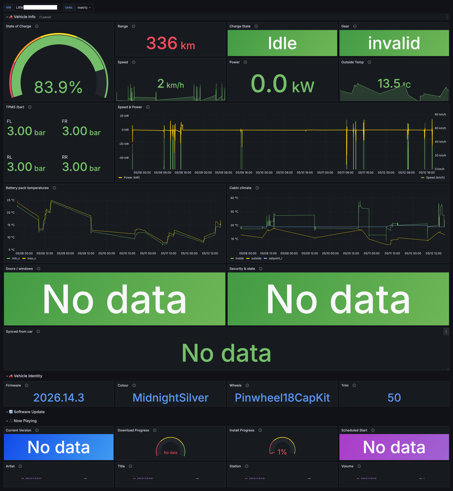
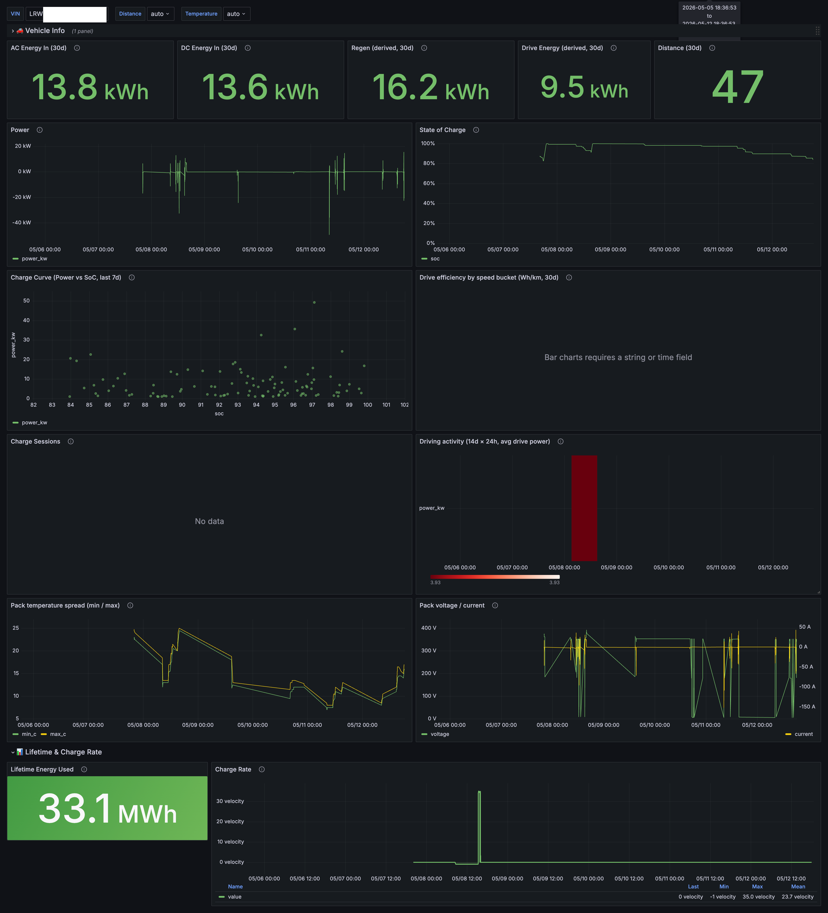
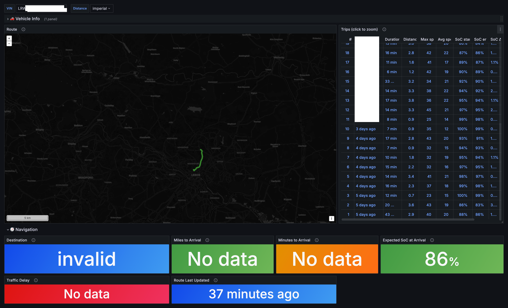
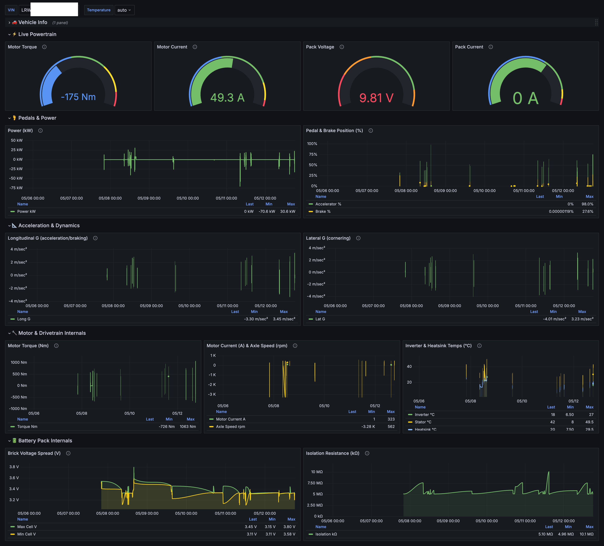
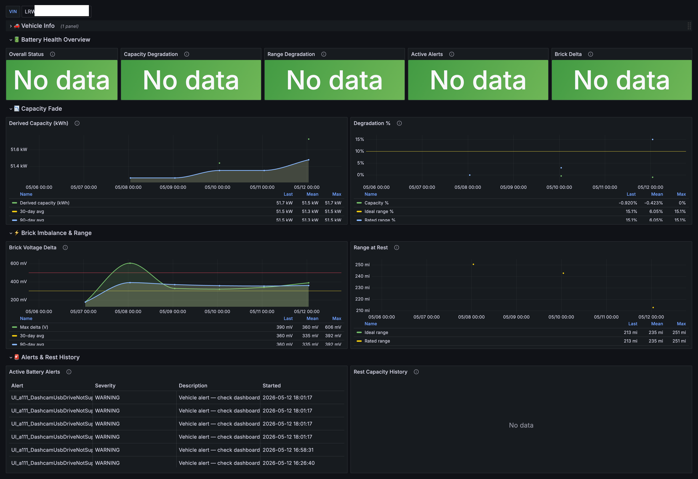
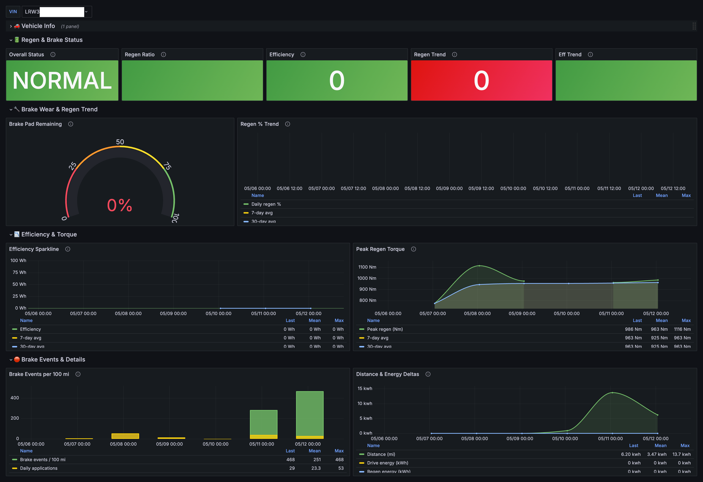
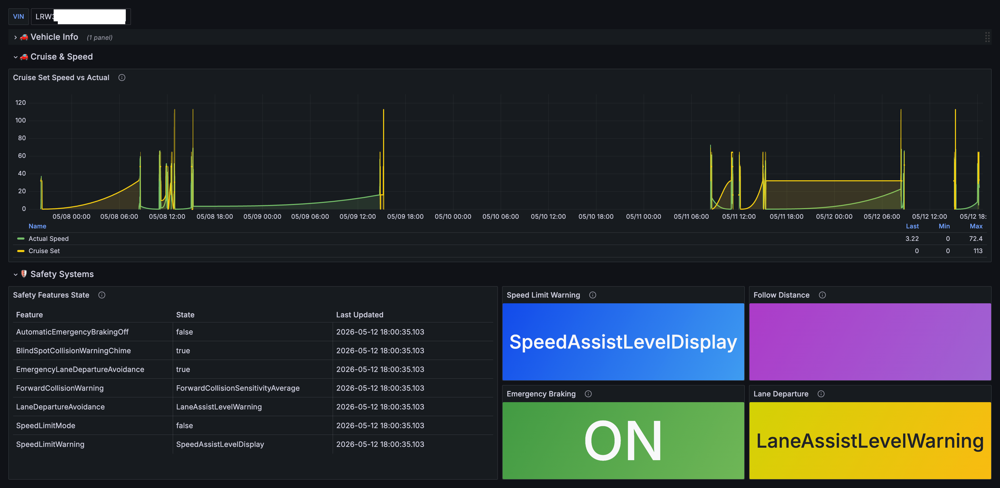
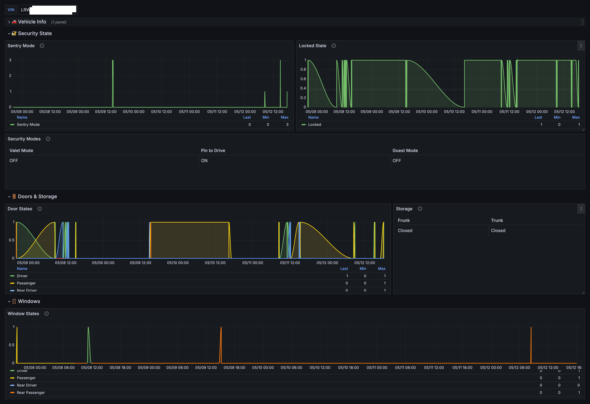

[](https://github.com/teslamotors/fleet-telemetry/actions/workflows/build.yml)
[](https://github.com/teslamotors/fleet-telemetry/tags)
[](https://hub.docker.com/r/tesla/fleet-telemetry/tags)

# Tesla Fleet Telemetry
---------------------------------

> **🚗 Fork Overview & Enhancements**
>
> This fork extends the official Tesla reference implementation into a **complete, production-ready observability stack**. It transforms the raw telemetry receiver into an end-to-end analytics platform with a TimescaleDB backend, predictive diagnostics across 11 vehicle subsystems, and 15 pre-built Grafana dashboards — served behind nginx mTLS.
>
> **Key Additions:**
> - **PostgreSQL / TimescaleDB Dispatcher:** A custom Go datastore module (`datastore/postgres/`) that writes incoming telemetry directly into TimescaleDB with continuous aggregates, compression, and 5-year retention.
> - **17 SQL Migrations:** Schema, views, unit-conversion functions, GPS-based trip sessionisation, charge session detection, and full predictive diagnostics for battery, drivetrain, heat pump, suspension, brakes, PCS, air suspension, dual motor, and Cybertruck subsystems (`deploy/sql/`).
> - **Predictive Health Engine:** Cross-subsystem risk scoring (`predictive_health_summary` view) that weights 11 subsystems into a single 0–100 risk score with recommended actions.
> - **15 Grafana Dashboards:** Pre-provisioned via Docker Compose with auto-discovery — see screenshots below.
> - **Telemetry Simulator:** Generates realistic 90-day synthetic history for dashboard development without a real vehicle (`tools/simulator/`).
> - **Extensive Deployment Runbook:** Covers Let's Encrypt + nginx mTLS, EC keypair generation, Tesla Developer API registration, virtual key pairing, and DNS automation (`deploy/README.md`).
>
> > ⚠️ **Experimental features:** The **Predictive Health Engine** (SQL views in `deploy/sql/014–017`) and the **Telemetry Simulator** (`tools/simulator/`) are early-stage beta features. Diagnostic scores and wear estimates may be inaccurate — do not rely on them for safety or maintenance decisions without independent verification.
>
> ### Upstream vs This Fork
>
> | Layer | Upstream | This Fork |
> |-------|----------|-----------|
> | **Ingest** | Go mTLS WebSocket server | Same — no core protocol changes |
> | **Persistence** | Kafka, Kinesis, Pub/Sub, MQTT, ZMQ | **+ PostgreSQL / TimescaleDB** |
> | **Schema & Analytics** | None | **+ Hypertables, PostGIS, trip views, unit-conversion SQL functions** |
> | **Visualisation** | None | **+ 15 Grafana dashboards** (Overview, Predictive Health, Energy, Alerts, etc.) |
> | **Testing** | Basic integration tests | **+ Synthetic telemetry simulator** covering all 239 vehicle fields |
> | **Deployment** | Helm chart reference | **+ Docker Compose stack + full operator runbook** |
>
> ### Architecture
>
> ```text
>                                Production Server (Ubuntu + UFW)
>                               ┌─────────────────────────────────────────────────────┐
>                               │                                                     │
>                               │  Nginx (HTTPS / Let's Encrypt / EC Key Serving)     │
> Owner (Browser) ── HTTPS :443 ─┼─►                                                   │
>                               │   │                                                 │
>                               │   │       Docker Compose Stack                      │
>                               │   │     ┌─────────────────────────────────────────┐ │
>                               │   └────►│ Grafana (:3003)                         │ │
>                               │         │   ▲                                     │ │
>                               │         │   │ (SQL Views & Dashboards)            │ │
>                               │         │   ▼                                     │ │
>                               │         │ TimescaleDB (PostgreSQL + PostGIS)      │ │
>                               │         │   ▲                                     │ │
>                               │         │   │ (Raw Telemetry Insert)              │ │
>                               │         │   │                                     │ │
> Tesla Vehicle ──── mTLS :4443 ─┼────────►│ fleet-telemetry (Go)                    │ │
>                               │         └─────────────────────────────────────────┘ │
>                               │                                                     │
>                               └─────────────────────────────────────────────────────┘
> ```
>
> - **TimescaleDB** stores every telemetry field as a single hypertable with composite PK `(ts, vin, field)`. PostGIS handles GPS points. Compression is enabled (7-day chunks).
> - **PostgreSQL dispatcher** is a first-class `telemetry.Producer` (~550 LOC, with integration tests). It unmarshals protobuf records, handles numeric/string/geo types, and writes in batches.
> - **SQL analytics layer** lives in `deploy/sql/`:
>   - `001_schema.sql` — hypertable, indexes, PostGIS
>   - `002_views.sql` — trip detection via GPS time-gap sessionization, energy per trip (kWh, Wh/km), battery drain, speed stats; pivotable user-preference views for dynamic unit conversion
>   - `003_grafana_role.sql` — read-only DB user for Grafana
>   - `004_field_catalog.sql` — searchable field metadata
> - **Grafana dashboards** use query variables (VIN selector, time range) and call SQL helper functions (`to_dist`, `to_temp`) so the same dashboard works for metric or imperial vehicles.
> - **Simulator** (`tools/simulator/`) generates realistic driving/charging data directly into TimescaleDB, letting you develop and demo dashboards without owning a Tesla or exposing a public endpoint.
>
> ### Key Technical Decisions
>
> 1. **Single hypertable, EAV-style** — One `(ts, vin, field, num_value, str_value, geo_value)` table instead of dozens of typed tables. This matches the streaming protobuf schema and makes adding new vehicle fields zero-downtime.
> 2. **Trip detection in SQL** — Rather than maintaining stateful session logic in Go, trips are derived via a SQL window function that detects >5-minute GPS gaps. This makes the definition inspectable, versioned, and easy to tune.
> 3. **Unit conversion at query time** — The car reports its preferred units as telemetry fields. Grafana reads the latest preference per VIN and passes it into SQL functions. No hard-coded units in the dashboards.
> 4. **Two-domain architecture** — `tesla.example.com` serves the mTLS fleet endpoint; `ft.example.com` serves the static EC public key for Tesla partner registration. This isolates the public-key serving requirement from the telemetry port.
>
> ### Dashboards
>
> | | |
> |---|---|
> | **Overview** — SoC gauge, rated range, odometer, inside/outside temp, charging power history, UK map position, TPMS pressures | **Summary** — Hero stats (SoC, range, charge state, power, temp), TPMS, speed/power chart, firmware version, colour, wheel spec |
> |  |  |
> | **Energy** — AC/DC/regen/drive kWh totals, SoC history, charge-curve scatter (power vs SoC), lifetime energy (33 MWh), pack voltage/current | **Map & Trips** — GPS route on dark map, per-trip table (duration, distance, avg/max speed, SoC start/end, energy used) |
> |  |  |
> | **Powertrain** — Live motor torque/current, pack voltage, longitudinal/lateral G-force, inverter temps, brick voltage spread, isolation resistance | **Battery Health** — Capacity fade trend, degradation %, brick voltage delta, range-at-rest history, active alert list |
> |  |  |
> | **Alerts** — Critical/urgent/warning counts, frequency timeline by subsystem, full alert history with severity and timestamps, 30-day trend | **Climate & Comfort** — Seat/steering heater usage, HVAC fan, defrost/AC modes, window states, climate settings, 12V battery cycling |
> |  |  |
> | **Regen & Brake Health** — Overall NORMAL/WARNING status, brake pad wear gauge, regen % trend, peak regen torque curve, brake events per 100 mi | **Safety & Autopilot** — Cruise set vs actual speed, safety feature states (AEB, blind spot, FCW, lane assist), speed limit and emergency braking status |
> |  |  |
> | **Security & Access** — Sentry mode timeline, locked state history, Pin-to-Drive/valet/guest modes, door and window open events over time | _(+ Drivetrain Health, Suspension & Alignment, Predictive Health)_ |
> |  | |
>

---

### Upstream Documentation

For the original Tesla Fleet Telemetry documentation (covering the Go ingest server architecture, Kinesis/PubSub configurations, and core protocol details), please see [docs/UPSTREAM.md](docs/UPSTREAM.md).

---

## License

This project is licensed under the [Apache License 2.0](LICENSE). 
- The original Go ingest server is copyright © 2024 Tesla, Inc.
- The Predictive Health engine, PostgreSQL/TimescaleDB analytics, and Grafana dashboards are copyright © 2026 Piotr Godlewski.
